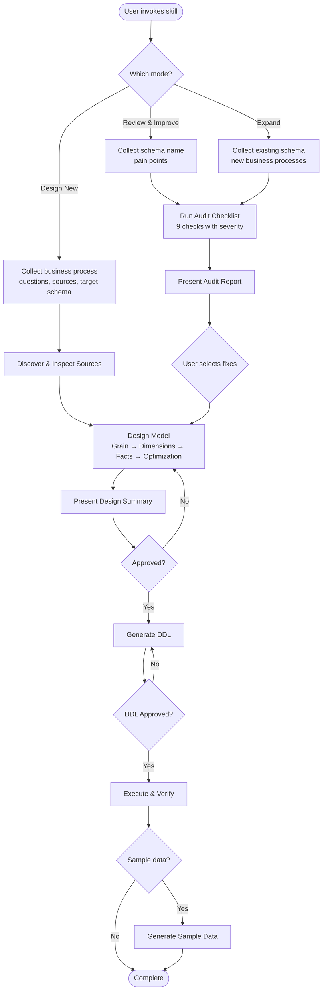
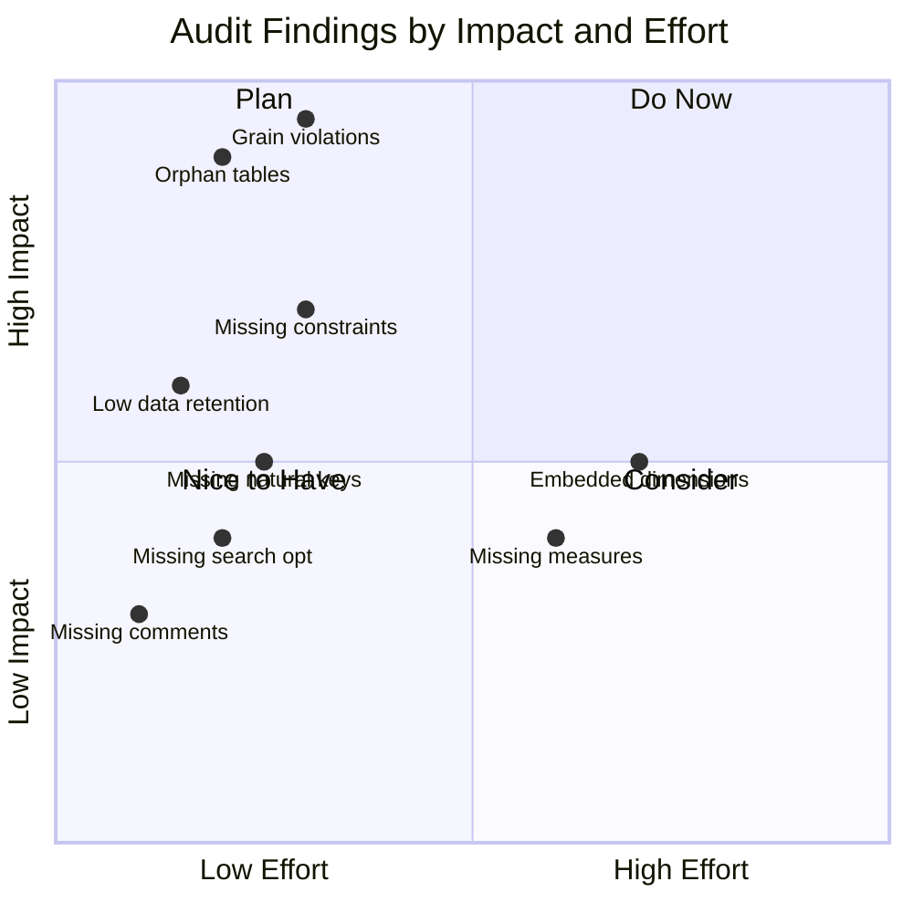
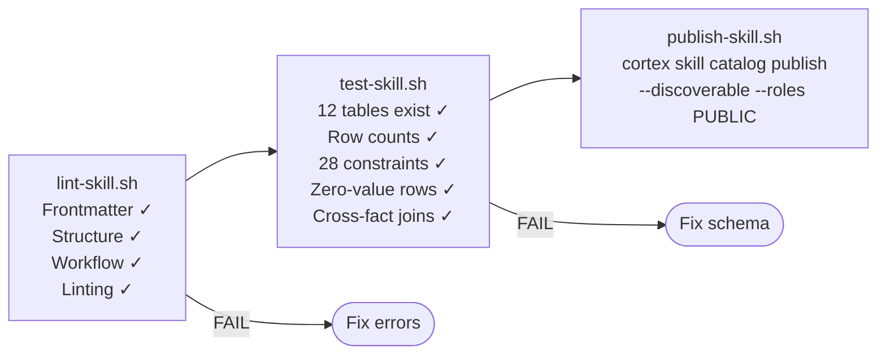
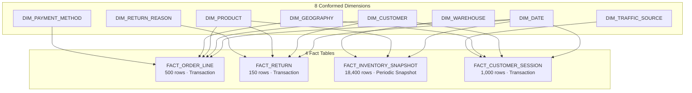

# Visual Diagrams for the Article

Companion visuals for **"I Taught an AI Agent the Kimball Methodology — Here's What It Built on Snowflake"**.

Paste into any Mermaid renderer or use Medium's code block with `mermaid` language tag.
The article already embeds Diagrams 2 and 6 inline. Use the others as supplementary images or social media visuals.

---

## 1. Full Star Schema — Entity Relationship

```mermaid
erDiagram
    DIM_DATE ||--o{ FACT_ORDER_LINE : "DATE_SK"
    DIM_CUSTOMER ||--o{ FACT_ORDER_LINE : "CUSTOMER_SK"
    DIM_PRODUCT ||--o{ FACT_ORDER_LINE : "PRODUCT_SK"
    DIM_GEOGRAPHY ||--o{ FACT_ORDER_LINE : "GEOGRAPHY_SK"
    DIM_PAYMENT_METHOD ||--o{ FACT_ORDER_LINE : "PAYMENT_METHOD_SK"

    DIM_DATE ||--o{ FACT_RETURN : "RETURN_DATE_SK"
    DIM_CUSTOMER ||--o{ FACT_RETURN : "CUSTOMER_SK"
    DIM_PRODUCT ||--o{ FACT_RETURN : "PRODUCT_SK"
    DIM_RETURN_REASON ||--o{ FACT_RETURN : "RETURN_REASON_SK"

    DIM_DATE ||--o{ FACT_INVENTORY_SNAPSHOT : "DATE_SK"
    DIM_PRODUCT ||--o{ FACT_INVENTORY_SNAPSHOT : "PRODUCT_SK"
    DIM_WAREHOUSE ||--o{ FACT_INVENTORY_SNAPSHOT : "WAREHOUSE_SK"

    DIM_DATE ||--o{ FACT_CUSTOMER_SESSION : "DATE_SK"
    DIM_CUSTOMER ||--o{ FACT_CUSTOMER_SESSION : "CUSTOMER_SK"
    DIM_GEOGRAPHY ||--o{ FACT_CUSTOMER_SESSION : "GEOGRAPHY_SK"
    DIM_TRAFFIC_SOURCE ||--o{ FACT_CUSTOMER_SESSION : "TRAFFIC_SOURCE_SK"

    DIM_DATE {
        NUMBER DATE_SK PK
        DATE FULL_DATE
        NUMBER YEAR_NUMBER
        NUMBER QUARTER_NUMBER
        NUMBER MONTH_NUMBER
        BOOLEAN IS_WEEKEND
        NUMBER FISCAL_YEAR
    }
    DIM_CUSTOMER {
        NUMBER CUSTOMER_SK PK
        VARCHAR CUSTOMER_ID NK
        VARCHAR CUSTOMER_NAME
        VARCHAR REGION
        VARCHAR CUSTOMER_SEGMENT
        BOOLEAN IS_CURRENT
    }
    DIM_PRODUCT {
        NUMBER PRODUCT_SK PK
        VARCHAR PRODUCT_ID NK
        VARCHAR PRODUCT_NAME
        VARCHAR CATEGORY
        VARCHAR SUBCATEGORY
        VARCHAR BRAND
    }
    DIM_GEOGRAPHY {
        NUMBER GEOGRAPHY_SK PK
        VARCHAR CITY
        VARCHAR STATE
        VARCHAR COUNTRY
        VARCHAR REGION
    }
    DIM_PAYMENT_METHOD {
        NUMBER PAYMENT_METHOD_SK PK
        VARCHAR PAYMENT_METHOD_ID NK
        VARCHAR PAYMENT_TYPE
        VARCHAR PAYMENT_PROVIDER
    }
    DIM_WAREHOUSE {
        NUMBER WAREHOUSE_SK PK
        VARCHAR WAREHOUSE_ID NK
        VARCHAR WAREHOUSE_NAME
        VARCHAR CITY
        NUMBER CAPACITY_UNITS
    }
    DIM_RETURN_REASON {
        NUMBER RETURN_REASON_SK PK
        VARCHAR REASON_CODE NK
        VARCHAR REASON_DESC
        VARCHAR REASON_CATEGORY
    }
    DIM_TRAFFIC_SOURCE {
        NUMBER TRAFFIC_SOURCE_SK PK
        VARCHAR SOURCE_NAME
        VARCHAR SOURCE_MEDIUM
        VARCHAR SOURCE_CAMPAIGN
    }
    FACT_ORDER_LINE {
        NUMBER ORDER_LINE_SK PK
        NUMBER DATE_SK FK
        NUMBER CUSTOMER_SK FK
        NUMBER PRODUCT_SK FK
        NUMBER GEOGRAPHY_SK FK
        NUMBER PAYMENT_METHOD_SK FK
        NUMBER QUANTITY
        NUMBER LINE_TOTAL
        NUMBER SHIPPING_COST
        VARCHAR ORDER_NUMBER DD
    }
    FACT_RETURN {
        NUMBER RETURN_SK PK
        NUMBER RETURN_DATE_SK FK
        NUMBER CUSTOMER_SK FK
        NUMBER PRODUCT_SK FK
        NUMBER RETURN_REASON_SK FK
        NUMBER REFUND_AMOUNT
        VARCHAR ORDER_NUMBER DD
        VARCHAR RETURN_NUMBER DD
    }
    FACT_INVENTORY_SNAPSHOT {
        NUMBER SNAPSHOT_SK PK
        NUMBER DATE_SK FK
        NUMBER PRODUCT_SK FK
        NUMBER WAREHOUSE_SK FK
        NUMBER QUANTITY_ON_HAND
        NUMBER QUANTITY_AVAILABLE
        BOOLEAN IS_STOCKOUT
        NUMBER DAYS_OF_SUPPLY
    }
    FACT_CUSTOMER_SESSION {
        NUMBER SESSION_SK PK
        NUMBER DATE_SK FK
        NUMBER CUSTOMER_SK FK
        NUMBER GEOGRAPHY_SK FK
        NUMBER TRAFFIC_SOURCE_SK FK
        NUMBER PAGE_VIEWS
        NUMBER SESSION_DURATION_SEC
        BOOLEAN IS_BOUNCE
        BOOLEAN IS_CONVERTED
        VARCHAR SESSION_ID DD
    }
```

## 2. Skill Workflow — Decision Flowchart (embedded in article)

Matches the simplified `flowchart LR` in the article. This is the expanded version with all three modes:



## 3. Audit Checklist — Severity Matrix



## 4. Conformed Dimension Reuse Matrix

Shows which existing dimensions each fact table references. **4 dimensions reused** across the 3 new fact tables (DIM_PAYMENT_METHOD is only used by FACT_ORDER_LINE).

| | DIM_DATE | DIM_CUSTOMER | DIM_PRODUCT | DIM_GEOGRAPHY | DIM_PAYMENT_METHOD | DIM_WAREHOUSE | DIM_RETURN_REASON | DIM_TRAFFIC_SOURCE |
|---|:---:|:---:|:---:|:---:|:---:|:---:|:---:|:---:|
| **FACT_ORDER_LINE** | ✓ | ✓ | ✓ | ✓ | ✓ | | | |
| **FACT_RETURN** | ✓ | ✓ | ✓ | | | | ✓ | |
| **FACT_INVENTORY** | ✓ | | ✓ | | | ✓ | | |
| **FACT_SESSION** | ✓ | ✓ | | ✓ | | | | ✓ |
| **Reused by new facts** | 3/3 | 2/3 | 2/3 | 1/3 | 0/3 | — | — | — |

## 5. CI Pipeline



## 6. Star Schema — Compact (embedded in article)

This is the diagram used inline in the article's "Expansion" section:



---

## Verified Numbers (fact-checked against live schema)

| Metric | Value | Source |
|--------|-------|--------|
| Total tables | 12 | `SHOW TABLES IN SCHEMA ECOMMERCE.ANALYTICS` |
| Dimensions | 8 | 8 `DIM_*` tables |
| Fact tables | 4 | 4 `FACT_*` tables |
| Primary keys | 12 | `INFORMATION_SCHEMA.TABLE_CONSTRAINTS` |
| Foreign keys | 16 | `INFORMATION_SCHEMA.TABLE_CONSTRAINTS` |
| Total constraints | 28 | 12 PK + 16 FK |
| Total rows | 23,067 | SUM of all table counts |
| Existing dims reused | 4 of 5 | DATE, CUSTOMER, PRODUCT, GEOGRAPHY (not PAYMENT_METHOD) |
| New dims added | 3 | WAREHOUSE, RETURN_REASON, TRAFFIC_SOURCE |
| DIM_DATE range | 2020–2027 | 2,922 rows |
| Warehouses | 5 real + 1 Unknown | 6 rows total |
| Return reason categories | 3 real + Unknown | Quality, Fulfillment, Changed Mind |
| Traffic source mediums | 6 real + unknown | organic, cpc, email, direct, social, referral |

---

## Tags & Metadata

**Medium tags** (3 recommended, 5 max):
1. `Data Engineering`
2. `Snowflake`
3. `Data Modeling`

**Additional if using 5:**
4. `Data Warehouse`
5. `SQL`

**Article title:**
> I Taught an AI Agent the Kimball Methodology — Here's What It Built on Snowflake

**Meta description:**
> How I built a Cortex Code skill that designs, audits, and expands Kimball-style star schemas on Snowflake — with conformed dimensions, semi-additive measures, and CI automation. Includes a full e-commerce model: 12 tables, 28 constraints, 23,000+ rows.

**Social sharing text:**
> I encoded the entire Kimball methodology into a Cortex Code skill on Snowflake. It built a 12-table star schema, caught 6 issues in my existing model, and expanded to 4 fact tables without breaking a single join. Here's how.
